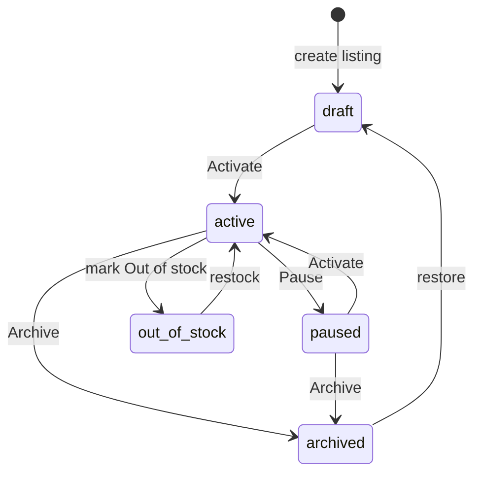

# Marketplace Module — Integration Plan

> Premium, pro-grade multi-channel selling built natively on the BNOS GLO data layer.

## 0. Situation

`marketplace` already exists as a `PermissionResource` (`src/lib/domain/permissions.ts`) and as a
feature toggle in **Settings → Features** (`bnos-os:features`). `order-sources.ts` already models
`marketplace` / `delivery` / social sources, and `ShippingInfo` already lives on every order.
**Everything below is net-new UI + 3 extension GLO types, reusing the established architecture.**

## 1. Architecture principles (respected throughout)

| Concern         | Pattern (from existing code)                                                          |
| --------------- | ------------------------------------------------------------------------------------- |
| Data            | `glo.upsert/all/get` reactive store → IndexedDB + Nostr relay sync                    |
| Extension types | short kebab type → NIP-78 `30078` fallback (see `domain/kind.ts`)                     |
| Lists           | `createListControls` + `ListToolbar` / `Pagination` / `SortableTh` / `RowActions`     |
| Sync            | `dataSync.pageSync([types], { scope })` in `onMount`                                  |
| Status → color  | `statusColor()` / `STATUS_COLORS` in `domain/meta.ts`                                 |
| Design tokens   | `surface-card`, `metric-card`, `--ui-*`, `--tone-*`, `segmented`, `is-active-surface` |
| Permissions     | `routePermissions` in `nav.ts` + `permissions.can(resource, action)`                  |
| Feature gate    | sidebar `section.feature` ↔ reactive feature flag                                     |

## 2. Data model

**3 new extension GLO types** (→ `30078`):

### `marketplace.channel` — a connected sales channel

```ts
interface MarketplaceChannel {
	name: string;
	type:
		| 'tiktok'
		| 'facebook'
		| 'instagram'
		| 'website'
		| 'amazon'
		| 'shopee'
		| 'lazada'
		| 'whatsapp'
		| 'tokopedia'
		| 'shopify'
		| 'custom';
	status: 'connected' | 'disconnected' | 'error' | 'pending';
	storeUrl?: string;
	syncEnabled: boolean;
	autoFulfill?: boolean;
	lastSyncAt?: string;
	logo?: string;
	config?: Record<string, string>; // apiKey (masked), region, currency override…
}
```

### `marketplace.listing` — a product published to ≥1 channel

```ts
interface MarketplaceListing {
	productId: string;
	productName: string;
	sku?: string;
	channelIds: string[];
	status: 'draft' | 'active' | 'paused' | 'out_of_stock' | 'archived';
	price: number;
	compareAtPrice?: number;
	channelPrices?: Record<string, number>;
	inventoryTracked: boolean;
	stock?: number;
	images?: string[];
	description?: string;
	publishedAt?: string;
	views?: number;
	clicks?: number;
	conversions?: number;
	channelStatus?: Record<string, 'published' | 'syncing' | 'rejected'>;
}
```

### Publishing and on/off (status)

The console controls whether a listing is live with two paths on
`/marketplace/listings`:

- the row **Pause / Activate** button (`quickStatus()` → `active` ↔ `paused`);
- the **Status** dropdown in the editor (`draft` · `active` · `paused` ·
  `out_of_stock` · `archived`). New listings start as `draft`.

Both call `glo.upsert(...)`, so the change is saved locally and published to
relays. What the buyer storefront does with each status:

| Status         | Browse / search / home / store | Direct `/product/[id]` | Can order          |
| -------------- | ------------------------------ | ---------------------- | ------------------ |
| `active`       | shown                          | shown                  | yes (if in stock)  |
| `paused`       | hidden                         | **shown**              | **yes**            |
| `draft`        | hidden                         | **shown**              | **yes**            |
| `out_of_stock` | hidden                         | **shown**              | yes if `stock > 0` |
| `archived`     | hidden                         | **shown**              | **yes**            |



Two gaps make "off" weaker than it looks:

1. **"On" does not reach the marketplace yet.** The console publishes with the
   `glo.upsert` default `visibility: "organization"`; the marketplace only
   accepts `visibility: "public"`. Until the console passes
   `visibility: "public"` for `marketplace.product` (and `.review`), no listing
   appears at all.
2. **"Off" is not enforced on direct links.** The marketplace product page has
   no status guard and `addToCart` does not re-check status, so a paused or
   draft listing is still orderable by URL.

The authoritative buyer-side rules live in
[`bnos-marketplace/docs/CONTRACTS.md` § Visibility and purchase gating](../../bnos-marketplace/docs/CONTRACTS.md#visibility-and-purchase-gating).

### `marketplace.review` — product/store review (pulled or manual)

```ts
interface MarketplaceReview {
	productId?: string;
	productName?: string;
	channelId?: string;
	channelName?: string;
	customerName: string;
	rating: 1 | 2 | 3 | 4 | 5;
	title?: string;
	body?: string;
	status: 'published' | 'pending' | 'flagged' | 'hidden' | 'replied';
	reply?: string;
	verified: boolean;
	helpful?: number;
}
```

**Reused (no new types):**

- Orders + Shipping → `commerce.order` filtered by `source ∈ REMOTE_SOURCES` / `channel === 'marketplace'`; `ShippingInfo.shippingStatus` drives the fulfillment board.
- Promotions → global `promotion` / `coupon` GLO types, scoped to online/channel offers.

## 3. Routes (file-based, mirrors `/settings` shell)

```
/marketplace                      Overview hub (KPIs + channel health)
/marketplace/listings             Listings CRUD (multi-channel publish)
/marketplace/channels             Sales-channel connections
/marketplace/orders               Marketplace orders (filtered commerce.order)
/marketplace/shipping             Fulfillment board (kanban by shipping status)
/marketplace/promotions           Channel offers (free shipping, coupons, %)
/marketplace/reviews              Reviews + reply workflow
/marketplace/settings             Storefront settings (per-channel)
/marketplace/analytics            Performance analytics + charts
```

`+layout.svelte` provides a sticky Marketplace sub-nav + a feature gate (redirect to a
"connect first" CTA when the module is disabled).

## 4. Foundation wiring checklist

- [x] `lib/features.svelte.ts` — **reactive** feature store (replaces the local-state version in `settings/features`). Powers live show/hide of nav.
- [x] `domain/kind.ts` — add `channel`, `listing`, `review` to `TYPE`.
- [x] `domain/types.ts` — add the 3 interfaces + a `Marketplace*` re-export.
- [x] `domain/meta.ts` — extend `STATUS_COLORS` for marketplace statuses.
- [x] `domain/marketplace.ts` — channel catalog (icon/brand color), listing status defs, review helpers — mirrors `order-sources.ts`.
- [x] `nostr/sync.svelte.ts` — register the 3 types in `SECONDARY_DATA_TYPES`.
- [x] `lib/nav.ts` — add **Marketplace** nav section (`feature: 'marketplace'`) + `routePermissions` for all 8 routes.
- [x] `lib/components/AppSidebar.svelte` — feature gate `marketplace` via `features.isEnabled`.
- [x] `domain/permissions.ts` — add `marketplace` to `PERMISSION_RESOURCES` + grant `manager` marketplace perms.

## 5. UX/UI — premium choices

1. **Dedicated gradient brand** for Marketplace (violet→fuchsia) to distinguish it from the teal POS core, while staying inside the token system.
2. **Hub-first IA**: `/marketplace` is a command center (revenue, orders to act on, channel sync health, low-stock listings) — one screen answers "what needs me?".
3. **Channel store-cards** with live status dots (reuse `.live-dot`), masked keys, one-click sync.
4. **Kanban fulfillment board** for Shipping (drag-style columns per `ShippingStatus`), not a plain table.
5. **Reusable `MarketplaceNav`** sub-nav with counts (orders pending, reviews unanswered…).
6. **Sparkline / bar charts** built from `dashboard/metrics.ts` helpers — no chart lib added.
7. **Empty states** that are actionable ("Connect a channel to publish your first listing").
8. **Responsive**: table → cards on mobile; sub-nav collapses to a back-link (mirrors settings shell).

## 6. Phasing

- **Phase A — Foundation** (wiring + reactive features + types + nav + permission)
- **Phase B — Shell** (`+layout`, `MarketplaceNav`, hub page)
- **Phase C — Pages** (listings, channels, orders, shipping, promotions, reviews, settings, analytics)
