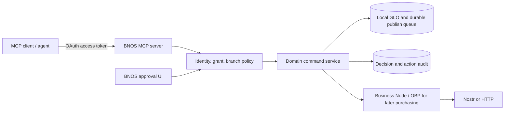

# BNOS MCP agent access plan

**Status:** proposal, 2026-10-08. This is a feature plan, not an implemented MCP endpoint. Related: [OBP overview](OBP_OVERVIEW.md), [OBP system plan](OBP_SYSTEM_PLAN.md), [OBP v0.1 spec](OBP_V01_SPEC.md), and [GLO mapping](OBP_GLO_MAPPING.md).

## Recommendation

Expose a **remote BNOS MCP server** as an adapter to a merchant's Business Node and local commerce services. An agent can read permitted data and submit bounded commands. The server authenticates the caller, resolves the merchant and branch, applies policy, executes through the same domain services used by BNOS, and records an audit receipt. MCP is the tool interface; Nostr carries identities and signed business messages where appropriate. Neither MCP nor a relay acknowledgement is authorization or proof that a stock or payment action succeeded.

Start with catalog reads and draft writes, then stock reads and proposed adjustments. Keep the existing GLO store as the operational source of truth during the pilot. OBP remains the separate contract for interbusiness RFQ, order, invoice and receipt exchange. Do not make catalog or stock mutations into OBP documents merely to expose them through MCP.

## Identity and authority

- An `npub` is the display encoding of a Nostr public key. It can name an agent or human, but possession of an `npub` grants **no access**. Do not ask an agent for a merchant `nsec`, browser signer, unrestricted NIP-46 connection, or wallet credential.
- For remote MCP, authenticate the connecting client with OAuth and short-lived access tokens. Bind the token to one organization, agent principal, allowed branch IDs, scopes, audience, expiry and revocation state. Verify all of these on every call. A merchant owner explicitly connects and authorizes the agent in BNOS; an `npub` may be linked to that agent record after proof of key possession, but it is not a bearer token.
- For Nostr-originated actions, verify the event signature and the node's own scoped key grant. Keep the OAuth client identity, optional Nostr pubkey and organization grant linked in one principal record. If remote signing is later offered, use NIP-46 with narrow method/kind permissions and still enforce BNOS policy. Avoid NIP-26 for the initial design; its current NIP is marked unrecommended.
- Evaluate permissions at the server/node boundary. The current `permissions.svelte.ts` checks are UI controls, not sufficient for an external agent. Grants need resource/action, org, branch, expiry, revocation and, for financial actions, amount/currency and budget limits. Never infer organization membership from an event's pubkey alone.
- The first release excludes payment execution, refunds, staff administration, key management and autonomous purchase-order approval. Later stages require explicit human approval, a trusted settlement verifier, and a tested revocation path.

## MCP interface, first release

Pin the server to a supported MCP protocol revision and document negotiated compatibility. Use remote HTTP transport and the official SDK; verify SDK support for the chosen revision before implementation. Publish a tool schema with strict input and output validation, stable error codes, pagination and tool annotations. Treat annotations as hints for clients, not authorization checks.

| Tool                                            | Behavior                                                                       | Required scope            | First release                              |
| ----------------------------------------------- | ------------------------------------------------------------------------------ | ------------------------- | ------------------------------------------ |
| `catalog_list_products` / `catalog_get_product` | Paginated, branch-aware read; redact internal cost unless separately granted   | `products:read`           | Yes                                        |
| `catalog_create_draft`                          | Validate SKU, unit, price/currency, tax fields and duplicates; persist a draft | `products:write`          | Yes, with merchant approval before publish |
| `catalog_update_draft`                          | Version-checked patch of allowlisted fields                                    | `products:write`          | Yes, with merchant approval before publish |
| `inventory_get_availability`                    | Read a branch/location projection with `asOf`, unit and sync status            | `inventory:read`          | Yes                                        |
| `inventory_propose_adjustment`                  | Propose quantity delta with reason, location, unit and source reference        | `inventory:write`         | Yes, approval required                     |
| `inventory_commit_adjustment`                   | Apply an approved proposal once                                                | `inventory:approve`       | Later, after ledger/reconciliation work    |
| `purchase_order_draft`                          | Create an OBP-backed draft from an approved supplier                           | `purchase_orders:write`   | Later                                      |
| `purchase_order_submit`                         | Human-approved signed OBP order                                                | `purchase_orders:approve` | Later                                      |

Every write request carries an idempotency key and expected record version. The response carries command ID, status (`proposed`, `awaiting_approval`, `applied`, `rejected`), record reference, and audit reference. Replays return the original result. Conflicts return the current version without silently overwriting a human edit. A local write can report `applied` while relay delivery remains `pending`; expose these as separate fields.

**Resources:** read-only schemas, branch list, catalog field guide and policy summary. Exclude customer personal data and private costs by default. **Prompts:** optional guided catalog setup; no hidden business authority. Keep the first release tool-focused.

## Stock model

Current stock is a local projection from inventory and order records. The OBP plan correctly defers a shared stock ledger. Before allowing agent-committed stock changes, define movement ID, product/variant, location, signed quantity, unit, reason, source document, actor, timestamp and correction link. Apply each movement exactly once and reconcile projections against existing adjustments and orders. Offline devices can still oversell; display stale data and require a fresh check before committing a reservation. Public marketplace availability is a separate bounded promise with an expiry, not the internal balance.

## Product flow for merchants

1. In **Settings → Agent access**, owner creates an agent connection, sees the requested scopes/branches and sets expiry. BNOS shows the agent's optional `npub` only after key-possession verification.
2. The agent calls catalog read tools, prepares draft products or a stock adjustment proposal, and receives a command ID.
3. BNOS shows a diff, affected branch, actor, reason and policy outcome in an approvals inbox. An authorized human approves or rejects. Approval rechecks record version and current policy.
4. BNOS records the decision and resulting local mutation, then publishes through the existing retry path. Activity shows local application and relay sync separately. The owner can revoke the connection immediately.

## Delivery tasks and exit gates

| Priority | Task                                                                                                 | Exit gate                                                                                    |
| -------- | ---------------------------------------------------------------------------------------------------- | -------------------------------------------------------------------------------------------- |
| P0       | Map current catalog/inventory write paths and define a framework-free command API                    | UI and MCP call the same validation/mutation functions; no direct MCP access to `glo.upsert` |
| P0       | Specify agent principal, OAuth scopes, org/branch grants, token storage, revocation and audit schema | Cross-org, wrong-branch, expired and revoked requests fail in integration tests              |
| P0       | Implement read-only remote MCP server with catalog and availability tools                            | Pagination, redaction, stale-data status and client compatibility verified                   |
| P1       | Add draft catalog commands, idempotency and optimistic concurrency                                   | Duplicate calls produce one draft; stale patches fail safely                                 |
| P1       | Build Agent access and approvals UI                                                                  | Owner can connect, inspect, approve, reject and revoke; each decision is auditable           |
| P1       | Add stock adjustment proposals and reconciliation report                                             | No proposal mutates stock before approval; report matches existing projections               |
| P2       | Define and migrate local stock movement ledger, then enable approved commits                         | Exactly-once application, corrections, offline conflict tests and rollback plan pass         |
| P2       | Add OBP purchasing tools after pilot write and approval gates                                        | Two-node exchange, signer scope, policy and settlement evidence checks pass                  |
| P3       | Add event-driven agent notifications and marketplace availability promises                           | Explicit opt-in, bounded exposure and expiry/retraction tested                               |

## Decisions to settle before implementation

1. Where will the always-on MCP server and durable authorization store run? The current Svelte app is client-rendered; a browser-only endpoint cannot protect agent credentials or enforce policy while the merchant is offline.
2. Is the first pilot one organization/one branch or multiple branches? Recommend one branch to prove policy and reconciliation.
3. Which MCP clients must connect first, and which protocol revision do their SDKs support? Test an actual client before committing to transport details.
4. Which catalog fields need human approval versus direct edits? Recommend approval for publish, price, tax and stock-impacting fields.

## Source notes

The [MCP 2026-07-28 specification announcement](https://blog.modelcontextprotocol.io/posts/2026-07-28/) describes the current stateless HTTP revision and authorization changes. The [MCP TypeScript SDK migration guide](https://ts.sdk.modelcontextprotocol.io/v2/migration/support-2026-07-28) covers support by protocol revision. Nostr [NIP-07](https://github.com/nostr-protocol/nips/blob/master/07.md) covers browser signers; [NIP-46](https://github.com/nostr-protocol/nips/blob/master/46.md) covers remote signing; [NIP-44](https://github.com/nostr-protocol/nips/blob/master/44.md) covers encrypted payloads; [NIP-26](https://github.com/nostr-protocol/nips/blob/master/26.md) is currently marked unrecommended. Recheck these sources at implementation time.
