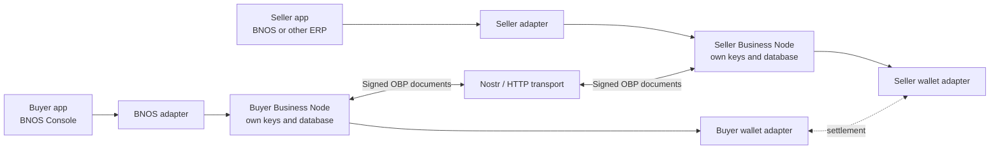
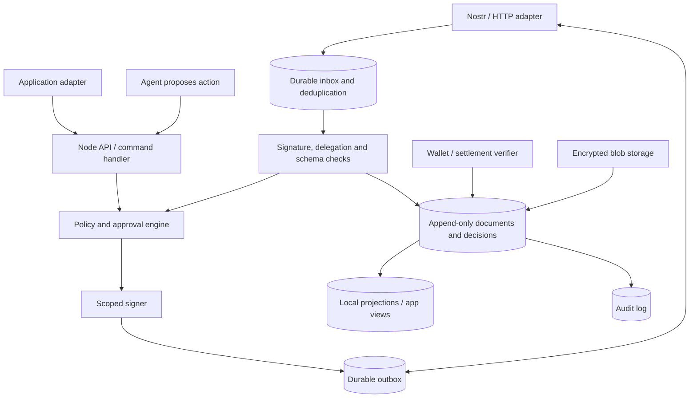
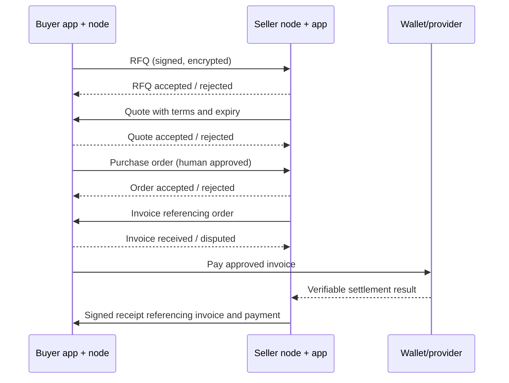
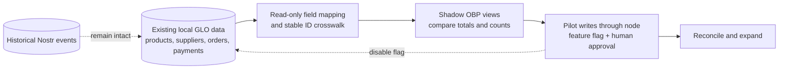
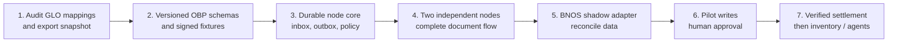

# OBP: the full picture

**Status:** proposed architecture, 2026-10-06; **v0.1 contract, node core and two-node conformance harness implemented 2026-10-07** in `src/lib/obp` + `src/lib/obp-adapter` (see [OBP_V01_SPEC.md](OBP_V01_SPEC.md)). This is the visual entry point for the idea. It distinguishes the existing BNOS system from components still to be built.

## Read this in one minute

**Open Business Protocol (OBP)** is the shared language for signed business documents and decisions. A **Business Node** stores, validates, authorizes and exchanges those documents for one organization. **BNOS Console / BitOS** is one application connected to a node; another company can use a different ERP. **Nostr or HTTP** carries messages between nodes. **Payment networks** settle money; OBP records requests and verifiable evidence. An **AI agent** may propose work under policy, but the node controls signing and approval.

The node is the trust boundary. A relay accepting an event, an app showing an order, and a wallet settling a payment are three different facts.

## What is inside one node?

The node must persist an incoming message and its decision together. It must retry outgoing delivery after a restart, reject invalid or duplicate messages, and keep a separate status for transport delivery, business acceptance and payment settlement.

## First complete business flow

This is the **v0.1 target**, not an existing feature. Discovery can start from a preconfigured supplier directory. Shipment, cross-border exchange, public supplier search, autonomous purchasing and shared stock movement are later extensions.

OBP purchasing is **not** a marketplace flow. RFQ → quote → purchase order →
invoice → payment evidence → receipt are confidential, bilateral documents
between two business nodes; they never appear as a public shop or listing.
Marketplace discovery is a separate public path — see
[OBP_GLO_MAPPING.md § Marketplace visibility](OBP_GLO_MAPPING.md#marketplace-visibility-not-an-obp-flow)
and [`bnos-marketplace/docs/CONTRACTS.md`](../../bnos-marketplace/docs/CONTRACTS.md#visibility-and-purchase-gating).

## How today's data moves into the new system

The adapter keeps `obpDocumentId ↔ localRecordId` mappings. Existing GLO objects and Nostr kinds remain valid. Signed OBP history remains available for audit even if the pilot feature is disabled. Stock balances are not exported as shared truth.

## Ownership and source of truth

| Concern                                              | Source of truth                                                     | Exists today?                                                |
| ---------------------------------------------------- | ------------------------------------------------------------------- | ------------------------------------------------------------ |
| BNOS POS, catalog and local operational records      | Current GLO store                                                   | Yes                                                          |
| OBP document bytes, hashes, signatures and lifecycle | Business Node document store                                        | Proposed                                                     |
| Delivery attempts and recipient acceptance           | Node outbox/inbox and signed decisions                              | Proposed                                                     |
| Spending authorization and approval                  | Node policy/approval records                                        | Proposed                                                     |
| Payment settlement                                   | Trusted wallet/provider, reflected into OBP only after verification | Partly: wallet integrations exist; OBP verification proposed |
| Internal stock position                              | Merchant inventory system / future local movement ledger            | Existing projections; ledger proposed                        |
| Public offer/discovery                               | Marketplace or directory, with explicit offer terms                 | Marketplace exists; OBP discovery proposed                   |

## Build order and exit gates

The first meaningful milestone is two independent nodes completing RFQ → quote → order → invoice → payment evidence → receipt without a shared database. See [OBP_SYSTEM_PLAN.md](OBP_SYSTEM_PLAN.md) for acceptance checks, failure cases and rollback.

## Document map

| Document                                   | Purpose                                                                                  |
| ------------------------------------------ | ---------------------------------------------------------------------------------------- |
| [idea.md](idea.md)                         | Original vision and examples.                                                            |
| [OBP_OVERVIEW.md](OBP_OVERVIEW.md)         | This page: visual system map and build sequence.                                         |
| [OBP_SYSTEM_PLAN.md](OBP_SYSTEM_PLAN.md)   | Contract boundaries, migration plan, risks and pilot gates.                              |
| [OBP_V01_SPEC.md](OBP_V01_SPEC.md)         | Normative v0.1 spec: schemas, canonical bytes, delegation, transport bindings, fixtures. |
| [OBP_GLO_MAPPING.md](OBP_GLO_MAPPING.md)   | Field-level GLO ↔ OBP mapping table.                                                     |
| [MARKETPLACE_PLAN.md](MARKETPLACE_PLAN.md) | Earlier marketplace plan; check current code for kind mappings.                          |
| [MCP_AGENT_PLAN.md](MCP_AGENT_PLAN.md)     | Proposed MCP access for scoped catalog, stock and later purchasing agents.               |

**Implemented in this repo (v0.1):** the contract (`src/lib/obp`), the Business Node core with durable inbox/outbox semantics (`src/lib/obp/node`), all three transports (loopback, HTTPS, Nostr with NIP-44 encryption), the KV/IndexedDB durable store, local Lightning preimage settlement verification, the two-node harnesses (`src/lib/obp/testing`), conformance fixtures (`src/lib/obp/*-test.ts`), the read-only BNOS adapter behind the `obp` feature flag (`src/lib/obp-adapter`), and the live app wiring: the browser node service (`node.svelte.ts` — session-key identity, supplier-seeded counterparties, relays, IndexedDB persistence) plus the flag-gated pilot console at `/obp` (document inbox, append-only logs, settlement status, audit trail, RFQ composition from purchase-order drafts). **Still to build:** wallet/provider-backed settlement (NWC), a server-deployed node for the HTTPS inbox binding (the app is client-first), and pilot-write reconciliation.
